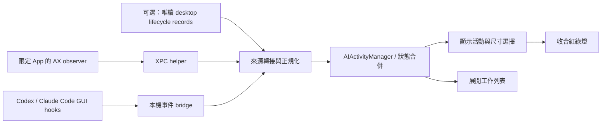

# AI 紅綠燈 Live Activity：研究與實作計畫

研究日期：2026-11-02（Asia/Taipei）。程式碼基準：`b7611bb`，目前分支 `main`。

本文件保留研究時的規劃。第一版已實作角色／三燈元件、AI 工作列表、設定、GUI hooks bridge 與保守的 AX adapter，使用方式及實際支援限制見 [功能指南](./ai-live-activity.md)。未自動安裝使用者 hooks，也未宣稱四個 App 的真實 GUI 事件皆已驗證。使用情境已確認：Codex、ChatGPT、Claude、Claude Code 都以 macOS 桌面 App GUI 為主；Claude Code 以 Claude Desktop 的 Code 分頁規劃，不要求使用者改用 CLI。

已確認的視覺要求：瀏海左側為各工具的 mascot animation（吉祥物動畫）；右側為 macOS 視窗燈號排列的三顆圓燈，由左至右紅、黃、綠。三顆同時存在，只點亮目前狀態，其餘兩顆 dim。

開源實作比對另見 [事件來源研究](./ai-live-activity-source-research.md)，包含固定 commit 的程式碼連結；第三方實作與本機實測結果分開標示。

## 1. 建議方向

在 Boring Notch 加入獨立的 AI Live Activity，分成三層：事件轉接器、共用狀態管理、SwiftUI 顯示。先驗證桌面 App 能提供哪些訊號，再承諾支援範圍。

產品沿用使用者指定的燈號語意：紅燈＝工作中、黃燈＝需要注意、綠燈＝本次工作完成。紅燈不拿來表示錯誤；錯誤以黃燈加上原因呈現。

內部額外保留未連接、閒置、已中斷與無法確認；畫面以三顆全部 dim 或隱藏整個活動呈現，不新增第四顆灰燈，也不把三燈替換成單顆圓點。無訊號不能自動判成完成。

## 2. 已確認的 repository 接點

以下路徑皆相對於 repository 根目錄。

| 檔案／位置 | 現況與實作影響 |
| --- | --- |
| `boringNotch/components/Live activities/LiveActivityModifier.swift:10` | 只有 activity enum 與左右內容 overlay；目前沒有完整的註冊、狀態或排程機制。全 repo 未找到 `.liveActivity(...)` 的使用點。新增 enum case 本身不會讓畫面出現。 |
| `boringNotch/ContentView.swift:61` | `computedChinWidth` 決定收合時瀏海寬度；新增 AI 活動要與畫面選擇共用判斷，避免內容被裁切。 |
| `boringNotch/ContentView.swift:245` | `NotchLayout()` 用條件分支切換電池、HUD、音樂、表情與展開內容；這裡才是實際活動入口。 |
| `boringNotch/ContentView.swift:389` | `MusicLiveActivity()` 是音樂收合畫面的實作，可參考左右配置、實體瀏海留白與高度計算。 |
| `boringNotch/ContentView.swift:134` | 目前點擊瀏海會展開；AI 詳細列表應接在展開後，避免與外層手勢衝突。 |
| `boringNotch/components/Notch/NotchHomeView.swift:421` | 展開首頁目前包含音樂、日曆、鏡頭；建議增加可收合的 AI 區塊，並檢查展開高度。 |
| `boringNotch/BoringViewCoordinator.swift:49` | 共用 coordinator 已負責畫面與偏好；適合承接顯示選擇，事件解析另放 manager。 |
| `boringNotch/components/Settings/SettingsView.swift:17` | 新增 AI Activities 設定頁、來源連線狀態與測試燈號入口。 |
| `boringNotch/boringNotchApp.swift:75` | 在 App 啟動／終止生命週期啟停 bridge、觀察器並清理資源。 |
| `boringNotch/boringNotch.entitlements` | 主程式啟用 App Sandbox，已有 network client/server entitlement；不應假定可以直接讀取其他 App 的資料目錄。 |
| `BoringNotchXPCHelper/BoringNotchXPCHelper.swift:15` | helper 已提供輔助使用權限查詢與請求；可評估增加限定 App 的唯讀 AX 觀察器。現有程式沒有 AI 狀態觀察功能。 |
| 兩份 `BoringNotchXPCHelperProtocol.swift` | 分別在 helper 與主程式目錄；增加 XPC 方法時必須同步更新。 |
| `boringNotch.xcodeproj/project.pbxproj` | 主程式使用明確的檔案與 Sources 列表；新增 Swift 檔須加入 target。deployment target 為 macOS 14。 |

這裡的 Live Activity 是 Boring Notch 自己的 SwiftUI 瀏海介面；本方案不需要導入 iOS ActivityKit。

目前在 `main`。若後續要回饋 upstream，依 `CONTRIBUTING.md`，程式碼貢獻應基於 `dev`。開始實作前確認基準分支，再建立功能分支。本輪沒有切換分支。

## 3. 各工具的狀態來源與可信度

### Codex 桌面 App

優先驗證官方 lifecycle hooks：送出工作、工具執行、權限請求、停止與中斷等事件可作為輸入。官方亦提供 app-server 的 thread/turn 狀態與待處理請求事件。[OpenAI Hooks](https://learn.chatgpt.com/docs/hooks)、[Codex App Server](https://learn.chatgpt.com/docs/app-server)

但「自行啟動 app-server」不等於「訂閱已開啟的 Codex 桌面 App」。第一階段應測試安裝版本是否會在桌面工作觸發受信任 hooks，以及事件是否足以辨識同時執行的聊天。不要假定可連入 App 的內部 server。

補充開源先例：`yazmorukyaz/codex-notch` 用唯讀 SQLite 找桌面 thread，再讀 rollout 的明確 lifecycle markers；這比 CPU／檔案更新時間推測更有依據，但仍是有版本相依性的本機資料格式。可列為 Codex desktop 的候選備援，由限定來源的唯讀 adapter 處理；不能把第三方成功等同於本機版本已驗證。

### Claude Code GUI（Claude Desktop Code 分頁）

官方桌面文件明確說明：設定中的 hooks 同時適用 CLI 與桌面 Code 分頁，因此 GUI 工作也有優先採 hooks 的依據。[Desktop shared configuration](https://code.claude.com/docs/en/desktop#shared-configuration)

開始／工具／權限與問答／停止或失敗事件可轉成狀態；實際支援事件依桌面內嵌 engine 的版本驗證。不要依賴終端機 status line 或 TTY。不要把延遲出現的 idle notification 當成黃燈，否則完成後會再次被誤判為等待注意。[Claude Code hooks](https://code.claude.com/docs/en/hooks)

CodeIsland 的 GUI 專用程式與測試提供額外證據：保留 hook session ID，也保留桌面 host session ID；後者可用來精準回到 Code 分頁中的工作。環境變數／deep link 屬第三方驗證結果，先在本機版本測試，不當成官方穩定 API。Code 分頁的 local、SSH、cloud 工作要分開宣告支援；本機 hooks bridge 不會自動涵蓋遠端。

### ChatGPT 桌面 App

分開處理一般聊天與 Work。官方 plugin 文件說明 Work／Codex 可使用 runtime hooks，但腳本必須存在於執行環境；雲端或隔離環境的 localhost 不能假定就是這台 Mac。[OpenAI plugin packaging](https://developers.openai.com/plugins/build/plugins)

一般聊天尚未確認有供第三方常駐程式訂閱的完整生命週期介面。先研究唯讀 macOS Accessibility（AX）觀察：例如生成中控制項、等待輸入介面與穩定的結果狀態。這是候選方案，尚未證明可行。

### Claude 桌面 App

一般 Chat 與 Cowork 分開處理。官方說明 hooks 可用於 Cowork／Claude Code，一般 Chat 不執行 hooks；Cowork 能否將事件送到本機 bridge，仍需驗證實際執行環境。[Claude plugins 支援範圍](https://support.claude.com/en/articles/13837440-use-plugins-in-claude)

一般聊天同樣先驗證 AX。Apple 提供依 App PID 取得輔助使用物件的 API，但這不保證特定 App 會公開足夠狀態。[Apple AXUIElementCreateApplication](https://developer.apple.com/documentation/applicationservices/1459374-axuielementcreateapplication)

### 桌面觀察的必要限制

- 測試前景、背景、最小化、多視窗、切換聊天及長時間工作。AX 無法看到的聊天不能列為已監看。
- App 開著、CPU 忙碌、通知聲響、停止按鈕消失，都不能單獨證明任務成功。
- 若只能可靠觀察目前聊天，設定頁要明示「僅目前可觀察聊天」，切換後原聊天標為無法確認，不能保留假的即時狀態。
- hooks、本機 lifecycle records、AX 是不同來源；同一聊天以可驗證的 runtime 訊號優先，較弱的 AX 訊號不得覆蓋它。
- `toby1991/chatgpt-cli` 有以 AX 觀察生成按鈕的先例，但它是會操作視窗的自動化工具。本方案只借用觀察方式；不藉由切換聊天、還原最小化視窗或搶焦點取得狀態，也不照搬「沒看到按鈕就當完成」的判斷。
- 瀏覽器擴充套件列為後續替代路徑，不是桌面 App 的解法。若使用者日後接受網頁版，再評估 content script → extension service worker → native messaging host。[Chrome Native Messaging](https://developer.chrome.com/docs/extensions/develop/concepts/native-messaging)

## 4. 狀態與完成定義

內部拆開記錄執行階段、待處理事項、結果與來源健康狀態，畫面再推導燈號。這樣能表示「還在工作，但已經有一個問題需要你回答」。

| 狀態 | 燈號 | 進入條件 | 退出方式 |
| --- | --- | --- | --- |
| working | 紅 | 已確認本次工作開始或繼續 | 確定的等待、完成、失敗或中斷事件 |
| needsAttention | 黃 | 等待授權、回答、登入，或遇到需要處理的錯誤 | 對應請求已解決、重試，或使用者明確確認 |
| completed | 綠 | 來源確認本次執行正常結束，且沒有未解決請求／相關工作 | 新一輪開始，或完成提示到期後從收合區隱藏 |
| idle / disconnected / unknown / interrupted | 三燈全 dim／整體隱藏 | 尚無工作、斷線、證據不足或使用者取消 | 收到新的可信事件 |

「一輪回答結束」不等於「使用者的整個目標達成」。第一版以可辨識的 root turn／run 為工作單位，詳細列表明示完成範圍；不宣稱程式碼已通過測試或整個專案已完成。

單靠 Stop hook 只能產生完成候選：其他 hook 可能要求繼續，最後訊息也可能在問問題。需要處理續跑、未解決請求與背景工作；無法確認時顯示「本輪已停止／待確認」，而不是承諾綠燈代表成功。短暫 debounce 只能減少閃爍，不能取代成功證據。

權限 hook 可能在自動審核前發生；必須區分「準備請求」與「真的等待使用者」。一般工具失敗但 AI 自行修復時，也不應一直亮黃燈。

每筆資料至少以 `provider + sessionId + runId` 識別，待處理請求再以 `requestId` 識別。子代理停止不代表主工作完成；同一工具的另一個聊天也不能被覆蓋。AX 無法提供穩定 run ID 時，使用來源限定的觀察 ID，並降低可宣稱的監看範圍。

Claude Chat 與 Claude Code GUI 即使在同一個 App process，也必須分別歸類為 `claudeChat` 與 `claudeCodeDesktop`；Code GUI 的 CLI session ID 與 desktop host session ID 都要保存，不能單憑 App bundle ID 合併兩個工具。

同一 provider 彙總順序：未處理黃燈 → 仍在工作的紅燈 → 最近完成的綠燈 → 閒置／未知。有一個聊天完成、另一個仍在跑時，不能整個 App 變成綠燈。

## 5. 建議畫面與顯示優先順序

收合配置固定為：`[ mascot animation ] [ 實體瀏海留白 ] [ 紅燈 黃燈 綠燈 ]`。

右側的三顆燈始終採相同水平順序與尺寸，不切換成單燈、不消失其中兩顆、不自動輪播顏色。三顆未亮時仍看得出各自色相；亮燈提高飽和度／亮度，搭配克制的內部高光，未亮燈使用暗色填色與輕微內陰影。不要靠整組 view 的 opacity 把目前亮燈一起變暗。閒置或未知時三顆都 dim。

尺寸起點：左側 mascot 約 24×24 pt、左翼寬約 40 pt；右側燈直徑約 8 pt、間距約 5 pt，燈組寬 34 pt，右翼加 padding 約 50 pt。以 `effectiveClosedNotchHeight` 縮放，並讓畫面與 `computedChinWidth` 使用同一份左右翼寬度；這些尺寸是待實測的設計值。中央保留實體瀏海區，內容不跨過鏡頭。右側只放三燈；工作數量放展開列表，維持完整排列。

### Mascot 動畫規格

- working：原地工作／走動的小幅循環，不移出左翼。
- needsAttention：停下工作、面向使用者，搭配低頻眨眼或抬頭；不以大幅跳動持續催促。
- completed：一次短暫的完成動作，再回到安靜姿勢；綠燈維持當前狀態。
- unknown／中斷：安靜的靜態姿勢，不繼續播放忙碌動畫。

角色外觀與工作狀態分開：同一組狀態驅動目前工具的角色。Claude Chat／Code 可以共用角色造型，但工具名稱及 session 分類必須清楚；Codex／ChatGPT 的具體角色資產尚未決定，不將第三方自創角色宣稱為官方 mascot。資產未定前用明確的佔位圖，不拿 emoji 當成正式角色。

優先評估小型離線 sprite sheet；向量角色則可使用 repo 已有的 Lottie 相依套件。現有 `LottieView` 以 URL 載入且 update 會重新 play，後續須增加 bundle asset 載入、狀態切換與暫停控制。動畫先以 12–20 fps 為預算，隱藏、螢幕鎖定、睡眠及 Reduce Motion 時停止不必要的計時器，避免每一幀重算整個瀏海 layout。

展開：呈現四個工具與各自工作列表，包含文字狀態、最後更新時間與來源是否可靠。點擊工作開啟對應 App；精準跳回聊天需驗證官方 deep link，沒有時先只開 App。黃燈附上簡短原因；不在瀏海直接代替使用者批准。

建議預設優先順序：沿用電池／HUD 短暫提示 → AI 黃燈 → AI 紅燈 → AI 綠燈短暫提示 → 音樂 → 表情。綠燈先暫定顯示 8 秒，之後收合區交回其他活動，完成紀錄仍留在列表。黃燈保持到原因解決；避免自動輪播把重要等待事項藏起來。

左右 mascot／三顆同時存在／只亮一顆是已確認要求；動畫細節、尺寸、與音樂優先順序及綠燈 8 秒提示時間是待實測的建議值。展開後以文字輔助辨識燈號，VoiceOver 能讀出工具及狀態；三燈是狀態顯示，不執行關閉、最小化或全螢幕動作。

## 6. 架構與檔案規劃

建議新增：

- `boringNotch/models/AIActivity.swift`：provider、session/run、pending request、結果、來源能力與健康狀態。
- `boringNotch/managers/AIActivityManager.swift`：以 MainActor 發布狀態，處理彙總、事件去重、過期與顯示生命週期。
- `boringNotch/services/AIActivity/`：本機 bridge、各 provider adapter；AX 觀察部分放 helper，透過明確型別的 XPC 資料回傳。
- `boringNotch/components/Live activities/AIActivityLiveActivity.swift`：收合畫面。
- `boringNotch/components/Live activities/AIMascotView.swift`：工具角色、狀態動畫及可見性暫停。
- `boringNotch/components/Live activities/TrafficLightView.swift`：三顆固定的紅黃綠燈，以單一 state 決定亮燈，三燈全 dim 表示未確認。
- `boringNotch/components/Live activities/AIActivityDetailView.swift`：展開列表。
- `boringNotch/components/Settings/AIActivitiesSettings.swift`：開關、來源能力、權限、測試燈號與安裝說明。
- `integrations/`：後續 hooks 範本、轉送小工具與可逆的安裝／移除說明。

修改現有 `ContentView`、`NotchHomeView`、settings、App lifecycle、XPC protocol 與 Xcode Sources。只抽出必要的活動選擇，讓畫面和尺寸使用同一結果；這一版不必重寫成通用外掛框架。

### 本機事件 bridge

開源案例顯示 Unix domain socket 與自有狀態檔皆可承接 hooks。P0 優先評估 `GUI runtime hook → 小型轉送器 → helper 的 Unix socket → XPC → 主程式`，讓主程式保留 Sandbox；同時驗證既有 helper 的生命週期是否適合承載 listener。socket 放使用者私有目錄、限制檔案及 peer 權限，檢查既有 listener，避免第二個 App instance 刪掉第一個的 socket。

若 helper／sandbox 整合成本不合理，保留 loopback HTTP 備選：App 已有 server entitlement，但仍須實測。HTTP 必須指定 loopback endpoint，不能只指定 port 而綁定全部介面。不要同時實作兩套正式 transport。[Apple requiredLocalEndpoint](https://developer.apple.com/documentation/network/nwparameters/requiredlocalendpoint)

事件欄位建議包含版本、event ID、provider、session/run/request ID、事件類型、來源時間與來源能力。具備序號的來源才使用序號排序；否則採來源規則、run 關聯與接收時間，不能憑全域抵達順序覆蓋狀態。

HTTP bridge 使用配對驗證憑證；Unix socket 驗證檔案所有者與連線 peer。兩者都限制 JSON 格式、大小與連線時間；來源欄位不接受任意 shell 指令。hooks 僅送狀態 metadata，不送 prompt、回答、完整 command 或逐字稿。連不上 bridge 時快速退出，依各事件要求輸出合法的無副作用回應，不影響 AI 工作。第一版不讓 hook 等待瀏海上的授權決策。

優先使用 hooks，避免頻繁掃描私人資料庫／逐字稿。若 P0 證明 Codex desktop 需要本機記錄備援，則只讀限定路徑與必要 metadata，隔離格式版本、增量讀取並可隨時停用；不讀認證檔或將對話內容帶進 UI。斷線以來源的連線或 heartbeat 能力判定；只有稀疏 hooks 的來源，長時間沒有事件不能直接等同失敗。App 重啟後先顯示來源尚未重新確認；未有 snapshot／重播機制前，不恢復假的紅燈或綠燈。

## 7. 分階段實作與交付

| 階段 | 工作 | 退出條件 |
| --- | --- | --- |
| P0：桌面可行性 | 確認桌面 App 與內嵌 Claude Code engine 的版本／模式；優先測試 Code GUI local session 的 hooks 與 host session ID，再測 Codex desktop hooks／唯讀 lifecycle records；對 ChatGPT／Claude Chat 做限定 App 的唯讀 AX 探測；驗證背景、最小化、多聊天與 transport。 | 產出每來源的「已觀察事件／無法觀察情境」矩陣。若一般聊天無可靠訊號，明列限制，再決定是否接受有限支援。 |
| P1：顯示與狀態核心 | 四工具的模型、彙總、左側 mascot 狀態動畫、右側固定三燈與全 dim 預覽；收合／展開元件、活動優先順序、共同尺寸計算及設定。 | 用模擬事件完整操作，三燈始終存在且最多一顆亮；動畫不超出左翼，音樂、HUD、電池與多螢幕切換不破版；模擬來源清楚標示。 |
| P2：正式事件接入 | 選定一種本機 bridge、Claude Code GUI／Codex desktop 轉接器、版本能力判斷與可逆安裝流程；驗證 GUI session 回跳。 | 真實 GUI 工作的開始、等待、恢復、完成候選、錯誤、中斷與並行聊天可重現；不要求啟用終端機，未有充分完成證據時不誤亮綠燈。 |
| P3：桌面聊天接入 | 依 P0 結果實作 ChatGPT／Claude AX adapter；Work／Cowork 只有在 host transport 實測成立時採 hooks。 | 在宣告支援的 App 版本與視窗狀態下驗收；無法觀察時即時降為未知並顯示原因。 |
| P4：整合驗收 | 啟停清理、權限撤銷、睡眠喚醒、斷線重連、版本更新失效、資源用量與 UI polish。 | 支援矩陣、限制與安裝文件齊全，完成下列驗收。 |

P0 應先做，因為使用者主要使用桌面 App；不能只完成 CLI 版就宣稱四個工具都支援。P1 可讓四個工具先有完整畫面，但模擬資料不代表來源整合已完成。

## 8. 驗收重點

1. 同一工具開兩個聊天，一個完成不會蓋掉另一個工作中／等待中的狀態；子代理結束不誤判整體完成。
2. 授權與問答顯示黃燈，請求解決後能恢復；自動審核立即通過不留下假黃燈。
3. 中斷、工具可自行恢復的失敗、API 錯誤與正常完成分得開；完成候選遇到續跑能撤銷。
4. 重複、延遲與不同 run 的事件不污染新工作；同一聊天的 hooks／AX 不互相覆蓋。
5. App 關閉、helper 中斷、權限撤銷、最小化或聊天不可觀察時不製造綠燈；重啟與睡眠喚醒不保留失真的狀態。
6. 黃燈與音樂、電池、音量 HUD 共存時優先順序穩定；實體／外接螢幕、全螢幕隱藏、不同瀏海高度與展開手勢符合現有偏好。
7. bridge 未開、錯誤資料與無效憑證不影響主 UI 或 AI 工作；安裝／移除整合保留既有使用者 hooks。
8. 對狀態 reducer、並行與亂序事件做必要單元測試；對實際 App 訊號做人工端到端測試。實作後建置並核對 helper 與主程式 target；本輪僅建立規劃文件，沒有執行 build。
9. 全程從 Claude Desktop Code 分頁啟動工作，沒有 TTY 也能收到事件；Claude Chat 與 Code GUI 不混淆，GUI 與 engine session ID 正確配對。
10. 紅黃綠三顆維持相同排列，任何時刻最多一顆亮，其他保持 dim；未知時全 dim。mascot 動畫與燈號由同一個衍生狀態驅動，切換時不出現角色忙碌但綠燈已亮的矛盾。

## 9. 下一個建議動作

進入 P0，先從有官方依據與開源 GUI 先例的 Claude Desktop Code 分頁開始驗證 hooks，再驗證 Codex desktop，最後處理 ChatGPT／Claude 一般聊天。視覺方向固定為左側 mascot animation、右側三顆紅黃綠燈；目前不把終端機整合作為交付 GUI 支援的替代品。
