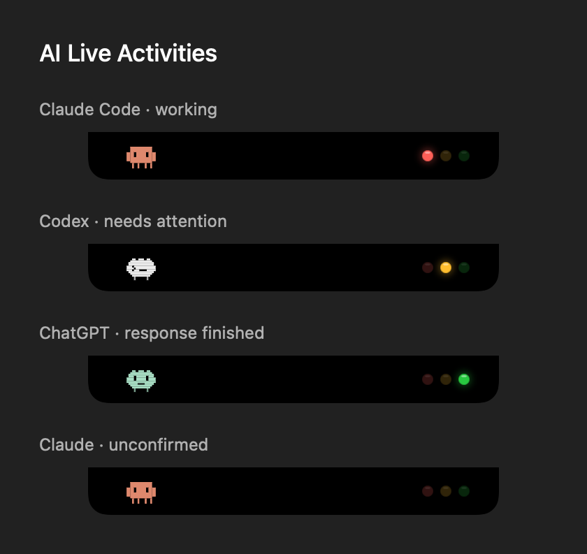

# AI Live Activities

AI companions live on the left of the notch. Three permanent lamps sit on the right, in macOS order: red, yellow, green. Only the current lamp illuminates; the others keep their dim color. Unknown, interrupted and idle states dim all three.



## Connect a local desktop coding session

1. Build and run this fork in Xcode.
2. Open **Settings → AI Activities**. AI live activities are enabled by default.
3. Click **Connect** beside **Claude Code** or **Codex**.
4. Start a **new local GUI session**. Claude Code refers to Claude Desktop’s **Code** tab. For Codex, review and trust the new hooks in its `/hooks` interface first; installing configuration does not grant hook trust.
5. Submit a task. Red means working, yellow means an outstanding question, approval or response failure, and green means the current response ended normally. Green is not a guarantee that the whole project is finished or tests passed.

The connector adds only its own hook commands, keeps one rolling private backup (`settings.json.boring-notch-backup`) of the configuration before its latest change, and preserves unrelated settings, matchers and path formatting. **Disconnect** removes its entries. It never answers an approval on your behalf. Settings shows which helper the hooks run. If the app moved, or the hooks were installed by another build (for example an Xcode Debug copy), the row shows **Reconnect** and the AI tab shows a warning. Hooks should point to a stable app location, rather than a temporary build directory.

**No hooks are installed merely by launching the app.** Setup occurs when you click Connect. The hook client is the embedded Swift helper itself: no Python, Node, shell script download or API key is needed.

## Read and preview states

- When the front companion turns yellow, the closed notch grows a row downward saying who needs you and why. It stays until the request is answered, or for about three seconds after you switch to the app that is waiting. A new question drops it again; activity on an already-seen question does not.
- Hover or click an AI activity to open the **AI tab**. Working and waiting sessions show as large cards with an animated companion and caption; finished and idle rows stay compact. Click a live row to return to its app.
- While red, the companion acts out the current tool: a book for reading, a magnifying glass for searching, a keyboard for editing, a terminal for commands and tests, a globe for the web, a small helper for delegated agents, and thought dots between tools. The AI tab shows the same thing as a caption such as “Editing ContentView.swift”. Yellow raises a “!”; green throws a little confetti. **Try the lights** can preview each action.
- Claude Code GUI session links use the host session ID when available. Otherwise the corresponding app is opened.
- Multiple sessions stay separate. An outstanding yellow state takes priority over red, and red takes priority over a completed response. A child agent ending never completes its parent.
- When several tools are active at once, the notch shows one companion per provider, overlapping like avatars so the notch does not widen. The most urgent one is in front and animates; the one behind keeps its pose. A number badge counts sessions of one provider, and “+N” counts providers beyond two. The lamps describe the front companion.
- Green stays in the compact notch until you return to the app that ran the session (Claude Desktop, or the terminal or editor a CLI ran in), then yields to music or other content about three seconds later. If you are already in that app when the response finishes, the same three seconds apply. Finished rows remain in the AI tab until dismissed. A runtime started without an app identity (for example over SSH) falls back to the provider’s desktop app.
- Battery and inline system HUDs keep their transient priority. The AI activity resumes afterwards. Existing full-screen hiding preferences still apply.
- **Try the lights** in settings previews all four tools and all-dim state without starting a task. Preview rows are labeled and expire after 20 seconds. End the preview to return to real events.

The pixel companions use offline Canvas drawing. The selected companion animates at approximately 12 fps; list rows remain static. Reduced Motion, screen locking, sleep and unmounting stop unnecessary character motion. Claude and Claude Code share a companion shape but keep distinct provider and session identities. The ChatGPT companion is custom artwork, not an official provider mascot.

## Ordinary ChatGPT and Claude chats

Enable **Observe ChatGPT and Claude chat windows** for the optional Accessibility adapter. Grant the XPC helper access when macOS requests it. It only inspects controls in the currently exposed conversation; it does not bring an app forward, unminimize windows, switch chats, read response bodies or capture screenshots.

This adapter is experimental and limited by what the installed app exposes. It can show red for a recognized generating control or yellow for a recognized approval control. A missing control alone never turns green: a stopped generation, navigation, error and normal finish can look alike. Other conversations, minimized windows and some background windows can be unobservable.

Some recent ChatGPT desktop distributions use the `com.openai.codex` identity. Local Work sessions in such distributions should use the Codex runtime hook connection; that does not automatically distinguish all Work conversations from Codex conversations. Ordinary ChatGPT Accessibility observation currently targets `com.openai.chat`. Cloud/SSH sessions and Cowork environments do not automatically reach this Mac’s private socket.

## Architecture and event semantics

```text
GUI runtime hook → embedded helper in hook-client mode
                 → same-user private Unix socket
                 → helper state reducer → XPC snapshot → SwiftUI

Optional exposed-window AX observation → helper snapshot
```

The main application retains its existing App Sandbox. The helper owns a private `/tmp/boring-notch-ai-<uid>/events.sock`; both ends check the peer user. Hook messages contain only event identity, request identity, project basename, optional GUI session ID and an action category with at most one short label (a file basename, program name, web host, agent type or MCP server name), not prompts, commands' arguments, search patterns, queries, output, credentials or environment dumps. Socket messages and read times are bounded. If Boring Notch is not listening, the hook exits successfully with the provider’s neutral output. Only one instance can own the socket; a second instance shows a warning in the AI tab instead of silently receiving nothing.

`Stop` is treated as a normal **response-end candidate**, rather than a completed overall goal. A 1.5-second continuation window, unresolved requests and tracked background agents prevent immediate green. Further runtime activity cancels the candidate. Other plugins can still continue after this observation window, so the indicator describes observed response state, not a transactionally guaranteed final result. Accessibility observations never create this completion candidate.

After app disconnection, helper restart, application exit or source loss, work is not restored as a fabricated completion. Desktop app lifetime applies only to hooks spawned by that app; terminal CLI sessions are not cleared when the desktop app is closed. A session with no hook for 30 minutes while red, or 8 hours while yellow, dims to unconfirmed, so a killed runtime cannot leave a lamp lit forever. Runtime IDs isolate conversations and turns; event IDs deduplicate replays. Delayed permission notifications are ignored in favor of identity-bearing request/result hooks.

## Verification

Run the dependency-free reducer, hook normalization, installer and real Unix transport tests:

```sh
sh Tests/AIActivityTests/run.sh
```

After building, exercise the actual embedded helper through XPC with an isolated temporary host app:

```sh
sh Tests/AIActivityTests/run-xpc-smoke.sh "/path/to/Boring Notch.app"
```

The smoke test uses its own XPC service identity and socket namespace, so it can run alongside an existing Boring Notch instance. It sends synthetic hook events through the real helper executable and observes red → yellow → red → green through XPC. It also verifies that reading hook configuration while monitoring is off does not start a listener.

Tests create an isolated fake home and private temporary socket; they do not install hooks into your real agent configuration. On a restricted execution host, the socket test needs permission to bind a local Unix socket.

The Xcode `boringNotch` scheme compiles both the application and helper. The shared model file is included in both targets. The SwiftUI preview image above is rendered from the actual component; it is not evidence that every installed provider’s GUI has emitted real events. Actual Claude/Codex hook trust and app-specific AX coverage still require exercising those GUI sessions after connecting.

Verified on 2026-11-02: the signed Debug application and helper built successfully with Xcode 27.1; all 39 core/installer/socket assertions passed; the isolated embedded-helper XPC smoke test passed, including readonly connection status and red → yellow → red → green. Existing unrelated project compiler warnings were not changed. A local test build is available under the ignored `build/ai-live-activities/Boring Notch.app` directory. Quit any existing Boring Notch instance before opening it, so only one instance owns the production event socket.

See [the original plan](ai-live-activity-plan.md) and [source research](ai-live-activity-source-research.md) for design rationale. Pixel body geometry is adapted from CodeIsland under the MIT notice included in `THIRD_PARTY_LICENSES`, also bundled with the app.
