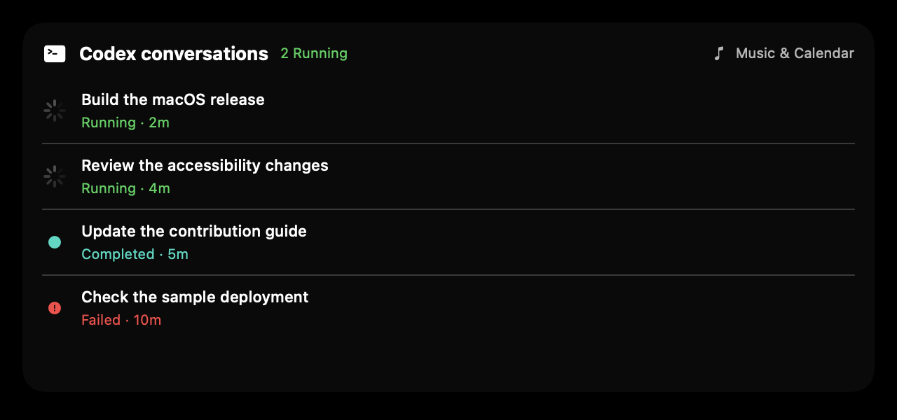

# Codex conversation live activity

This optional integration is a passive, read-only conversation status panel. It adds a Codex activity to the existing closed-notch stack, below notifications and above music. Opening the home tab shows recent Codex conversations; notifications and the shelf keep their existing precedence. The expanded panel can switch back to Music & Calendar.

## Connect

Open Settings → Codex and choose the actual `~/.codex` directory in the macOS system picker. A security-scoped, read-only bookmark persists access across launches. Disable the integration or choose **Forget folder access** to release that access. The default directory is derived from the login user's home, rather than the app sandbox's container home.

The folder grant covers the chosen directory, which can contain sensitive configuration. The implementation only opens the activity SQLite indexes read-only and enumerates rollout filenames. It does not query credential files or transcript bodies. Its own task-name cache lives in the app container's Application Support/CodexNotch directory and must not be included in screenshots or distributions.

## Display and semantics

- Refresh every two seconds, with running conversations first and up to 12 recent conversations in the scrollable panel.
- Correlate runtime session IDs in `thread_turns` with conversation IDs in `threads` using rollout filenames.
- Prefer the explicit conversation `name`, then `title`, and persist resolved names in the app-local cache.
- Display the latest observed turn state: Running, Completed, Interrupted, Failed, or Idle. Completed describes a turn and is not a judgment that a whole project succeeded. A conversation without an observed turn in the recent window is Idle.
- Exclude archived conversations and internal subagent conversations. The recent turn window is 24 hours, so abandoned old records do not remain active forever.

The SQLite schema and rollout filenames are undocumented local integration details. Schema failures show a connection error, never simulated running activity. This feature does not infer waiting-for-approval states, inspect response prose, submit prompts, or provide permission actions. It complements the event-driven notification proposal in upstream #1472 rather than replacing that workflow.

## Preview

The image below is rendered from the production expanded view using synthetic names and states. It contains no private conversation data.

## Verification

`CodexActivityScannerTests` creates isolated synthetic databases and verifies runtime-to-conversation mapping, local name persistence, read-only source access, multiple active conversations, terminal states, latest-turn selection, archived/subagent exclusion, and malformed database behavior.

The main-based personal application was also tested with two real concurrently running conversations. That private UI capture is deliberately not part of this contribution.

### Local toolchain result

The focused five-test XCTest suite passed using the production scanner and the same test file in an isolated SwiftPM harness. The complete feature source also passed a Swift 5 type check against minimal app-type stubs, and the integration files passed parsing checks.

A full `dev` build on Xcode 27.0 beta / Apple Swift 6.4 (`swiftlang-6.4.0.20.104`) stops in upstream `swift-collections` 1.7.3 before the application module, with unavailable/mismatched `Iterable` and `BorrowingIteratorProtocol` APIs. An untouched checkout of upstream `dev` at `c3d077b3f8624ba133f25bcf8547335ff27f72d8` reproduced that dependency failure. No dependency pins or translation catalogs are changed by this contribution. Full app validation of the dev-based port remains pending on a compatible toolchain; the separate main-based application release passes its full Release build.
